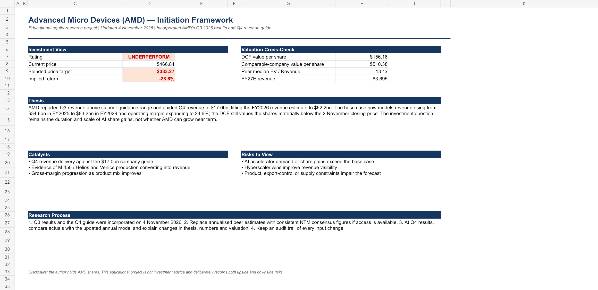

# AMD Equity Research

An undergraduate equity-research project on Advanced Micro Devices, Inc. (AMD), built from public company filings and earnings releases.

## Investment question

Does AMD's AI-driven revenue growth and prospective margin expansion justify its market valuation?

## What is included

| File | Purpose |
| --- | --- |
| `AMD_Equity_Research_Model.xlsx` | Historical financials, linked three-statement forecast, DCF, comparable-company valuation, source trail and earnings update |
| `AMD_Initiation_Memo.pdf` | One-page initiation memo setting out the thesis, catalysts, risks and valuation |
| `AMD_Q3_2026_Earnings_Update.pdf` | One-page update following AMD's Q3 FY2026 release |
| `model-summary.png` | Preview of the model summary tab |

## Approach

The model uses reported historical data and public company disclosures to forecast revenue, gross margin, operating costs, working capital and cash flow. It values AMD using:

1. a discounted cash flow analysis based on forecast unlevered free cash flow; and
2. an EV / revenue comparison with selected semiconductor peers.

The Q3 FY2026 update compares reported revenue and non-GAAP gross margin with AMD's prior Q2 outlook, incorporates the company’s Q4 guide into FY2026 revenue, and refreshes the valuation using reported Q3 net cash.

## Key limitations

This is an educational project, not investment research or investment advice. Valuation is highly sensitive to the forecast, discount rate, terminal value and peer-multiple assumptions. Comparable-company inputs are deliberately simplified and should not be treated as consensus estimates.

## Model preview

## Sources

Primary inputs are drawn from AMD's Form 10-K, quarterly earnings releases and SEC filings. The source trail, URLs and input notes are included in the workbook’s **Sources** sheet.

## Author disclosure

The author holds AMD shares. This disclosure is included so that readers can assess potential bias.
